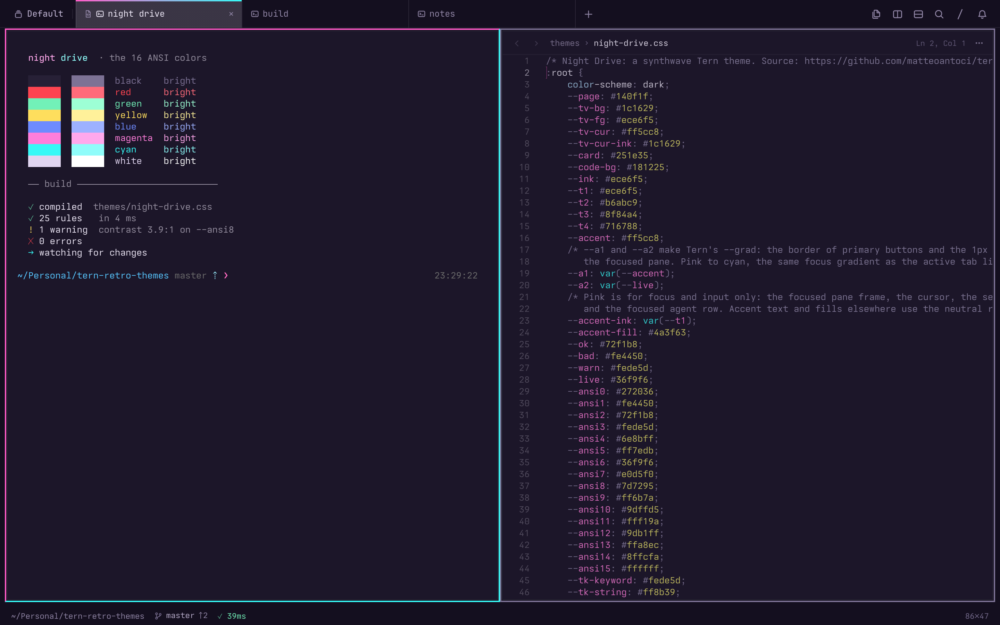
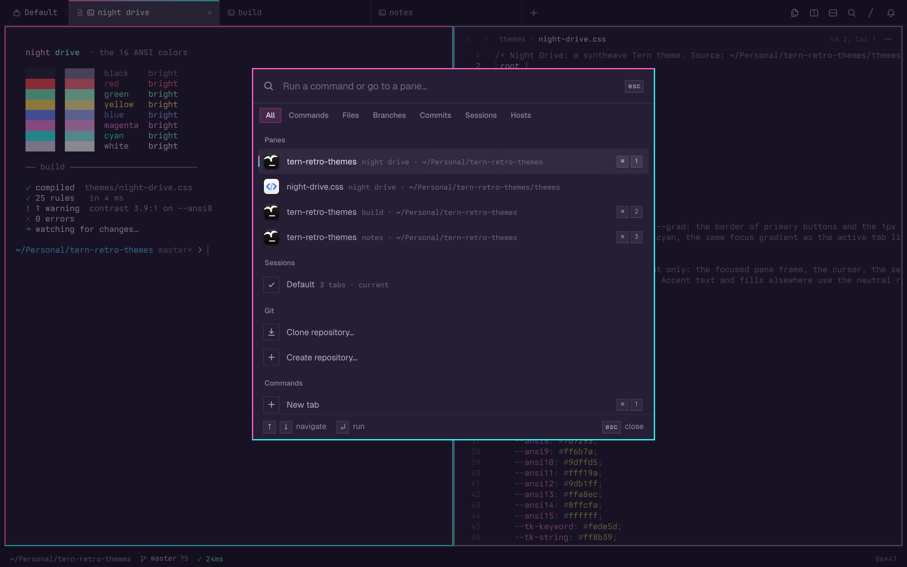

<div align="center">

# 🌃 Night Drive

**A synthwave theme for [Tern](https://docs.stencil.so/tern/).**<br>
Neon shows only where your focus is. Tiles are square, tabs are flat, and the rest stays calm.




</div>

---

## ✨ Highlights

- 🎯 **Neon on focus.** The focused pane gets a 2 px frame: pink on the top and left edges, cyan on the right and bottom. The active tab gets the same pink-to-cyan line. Everything else stays quiet.
- 🟪 **Square tiles.** Every corner is square, after [Omarchy](https://github.com/omacom/omarchy). Spinners stay round.
- 📑 **Flat tab cells.** Tabs are 240 px cells with 1 px dividers, in a mono font. Hover is an 8 % fill, the active tab an 18 % fill, a pressed tab 22 %.
- 🌈 **SynthWave '84 colors.** The ANSI palette and the code colors come from [SynthWave '84](https://github.com/robb0wen/synthwave-vscode), tuned for contrast.
- 🧘 **No noise.** There is no glow, no blur, no sun and no grid floor. Motion shows only where it has a meaning: a 539 ms fade when the focus moves, and no fade when Reduce Motion is on.

## 🎨 Palette

Each color has one job. A color that means "focus" never means "data".

| | Color | Hex | Job |
|:-:|---|---|---|
|  | **Hot pink** | `#ff5cc8` | Focus and input: the pane frame, the cursor, the selection, the composer |
|  | **Neon cyan** | `#36f9f6` | Live state: a working tab, the second half of the focus frame |
|  | **Electric blue** | `#6e8bff` | omp data and highlights: charts, bullets, the model chip, working agents |
|  | **Lavender white** | `#ece6f5` | Text and chat headings |
|  | **Mint** | `#72f1b8` | Success |
|  | **Sun yellow** | `#fede5d` | Warning, waiting |
|  | **Red** | `#fe4450` | Error |
|  | **Night** | `#140f1f` | The page behind the tiles |
|  | **Dusk** | `#1c1629` | Terminal and pane background |

## 🚀 Install

> [!NOTE]
> Run these steps in a Tern pane, so that `tern ctl` finds your window. The setup needs `jq`.

```sh
git clone https://github.com/matteoantoci/tern-night-drive.git
cd tern-night-drive
./setup.sh
```

`setup.sh` is safe to run more than once. It does 3 things:

1. 🔗 It links `themes/night-drive.css` into Tern's themes folder and selects Night Drive. An edit in the repo reloads live.
2. 🪟 It sets the island layout, a 14 px terminal padding and the status line.
3. ▮ It sets a blinking block cursor in `settings.json`. Run `tern restart` once to see it.

<details>
<summary><b>Only the theme, no settings</b></summary>

```sh
ln -sf "$PWD/themes/night-drive.css" "$HOME/Library/Application Support/Tern/themes/night-drive.css"
tern ctl theme night-drive
```

</details>

## 🧭 Design rules

<table>
<tr>
<td width="50%" valign="top">

**🎨 Color**

- Pink means focus or input. Nothing else.
- Cyan means live. Blue means data.
- Text and headings are white. Size and weight mark a heading.
- State colors (mint, yellow, red) are only for state.

</td>
<td width="50%" valign="top">

**🔤 Type**

- Mono for the frame and for machine text: the tab bar, the status line, the composer, code, paths.
- Sans for content that you read: chat, menus, sidebars.
- No italic for emphasis.

</td>
</tr>
<tr>
<td valign="top">

**🧱 Shape**

- Square corners. Only spinners and status rings stay round.
- 2 px frames on every pane: muted at rest, pink and cyan on focus.
- One focus marker per pane. Tern's own 1 px focus line is hidden.

</td>
<td valign="top">

**🧩 Tokens first**

- Colors and corners come from Tern's tokens where a token exists.
- An element rule only where no token exists, with a comment that says why.
- No rule targets a plugin, so plugins look right with any theme.

</td>
</tr>
</table>

## 🔍 The command palette

<div align="center">

</div>

The palette gets the same 2-color frame as the focused pane. The palette and every dialog get a flat background and a 50 % scrim, after Omarchy's popups.

## 📸 Screenshots

The screenshots show demo content only. To render them again:

```sh
./assets/shoot.sh
```

The script opens a headless `tern serve` window, runs [`assets/screenshot.txt`](assets/screenshot.txt) and writes the PNG files to `assets/`. Your own windows do not change.

## 🗂️ Repo layout

```text
tern-night-drive/
├── themes/
│   └── night-drive.css    # the theme
├── setup.sh               # links the theme and applies the window settings
├── LICENSE                # MIT, with the SynthWave '84 credit
├── assets/
│   ├── screenshot.txt     # the screenshot scenario
│   ├── shoot.sh           # renders the screenshots offscreen
│   └── palette.sh         # prints the 16 ANSI colors
└── research/
    ├── omarchy.md         # what Omarchy and herdr-omarchy do, with sources
    └── retro-themes.md    # SynthWave '84 and other retro palettes
```

## 🙏 Credits

- 🌆 [SynthWave '84](https://github.com/robb0wen/synthwave-vscode) by Robb Owen (MIT): the palette. The ANSI and code colors use its values, some tuned for contrast.
- 🧱 [Omarchy](https://github.com/omacom/omarchy) and [herdr-omarchy](https://github.com/shafiqimtiaz/herdr-omarchy): square tiles, flat tabs, focus frames.
- 🖥️ [Tern](https://docs.stencil.so/tern/) by Stencil: the terminal that this theme dresses.

## 📄 License

[MIT](LICENSE). The palette is based on SynthWave '84, © 2019 Robb Owen, also MIT.

<div align="center">
<sub>Night Drive is for late-night code sessions. 🌙</sub>
</div>
